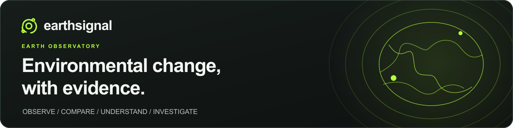

<div align="center">



# Earthsignal

**The ground under Tehran is sinking. NISAR can see it.**

An interactive story built on real NISAR radar observations for NASA Space Apps 2026, *Dancing with the SARs*.

**[Open the story →](https://nasa.r8volt.com)**

</div>

## What it shows

A scroll-driven story that takes you from groundwater beneath a city to the radar measurements that reveal it:

1. **Hidden cause:** pumping water squeezes fine sediment, and the ground above settles.
2. **Consequences:** neighbouring places sink at different speeds and strain the roads and pipes between them.
3. **From space:** how two radar visits reveal a change in distance.
4. **Real ground:** NISAR radar images of south-west Tehran, plus a time-lapse of four months of vertical motion that you scroll through.
5. **Another path:** how Tokyo slowed its subsidence.

A five-mission game version is available at `/?mode=game`.

## The data

- **Source:** NISAR L2 GUNW interferograms, 36 pairs (18 June–21 October 2026, provisional products, 80 m pixels):
  - ascending track 56 (frames 19 and 20)
  - descending track 136 (frames 70 and 71)
- **Method:** sequential pairs are chained into a cumulative displacement per date, and the two viewing directions are combined to separate vertical from east–west motion. Results are referenced to the median of the whole area.
- **Result:** about 1,240 km² measured. In the fastest neighbourhood the ground is sinking about 30 cm a year, which is about 10 cm over the 120 days of observations.
- **Bundle:** results ship as a hash-verified bundle in [`public/data/nisar/tehran-sw-2026`](public/data/nisar/tehran-sw-2026).

The numbers show ground motion, not building safety. The products are provisional and the 3D buildings are illustrative.

## Run it

You need Node 22.13 or later.

```sh
npm ci
npm run dev        # http://127.0.0.1:5173
```

To rebuild the time-lapse from cached NISAR crops (this needs Earthdata credentials to fetch them):

```sh
PYTHONPATH=. python -m service.ground_motion_timeseries \
  --bundle public/data/nisar/tehran-sw-2026 --cache .nisar-cache
```

## Project layout

| Path | What it holds |
|---|---|
| `app/` | Routes: story `/`, `/explore`, `/compare`, `/workspace` |
| `features/public-story/` | The story, the game and the time-lapse |
| `features/ground-truth/` | 3D city scenes and the result-bundle loader |
| `service/` | Python NISAR processing (GUNW reading, ground motion, time series) |
| `public/data/` | Frozen result bundles |
| `scripts/` | Build, release check and deployment |

More detail: [service guide](service/README.md), [deployment](docs/deployment.md), [reproducibility](docs/reproducibility.md), [contributing](CONTRIBUTING.md).

---

Built for NASA Space Apps 2026. This does not imply NASA or ISRO endorsement.
