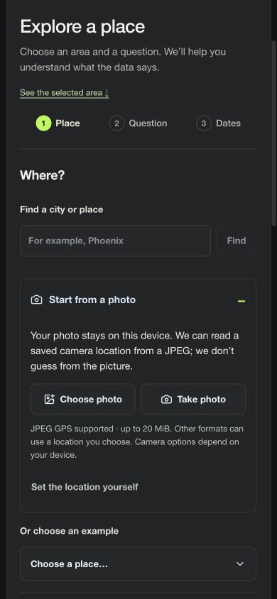
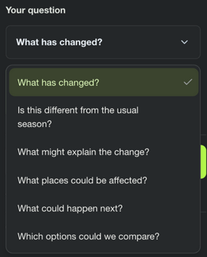
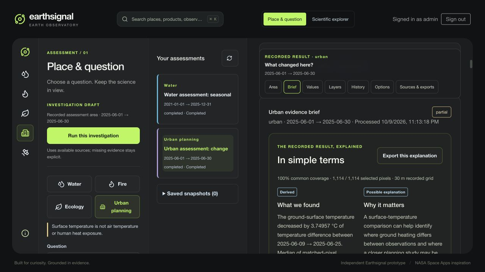
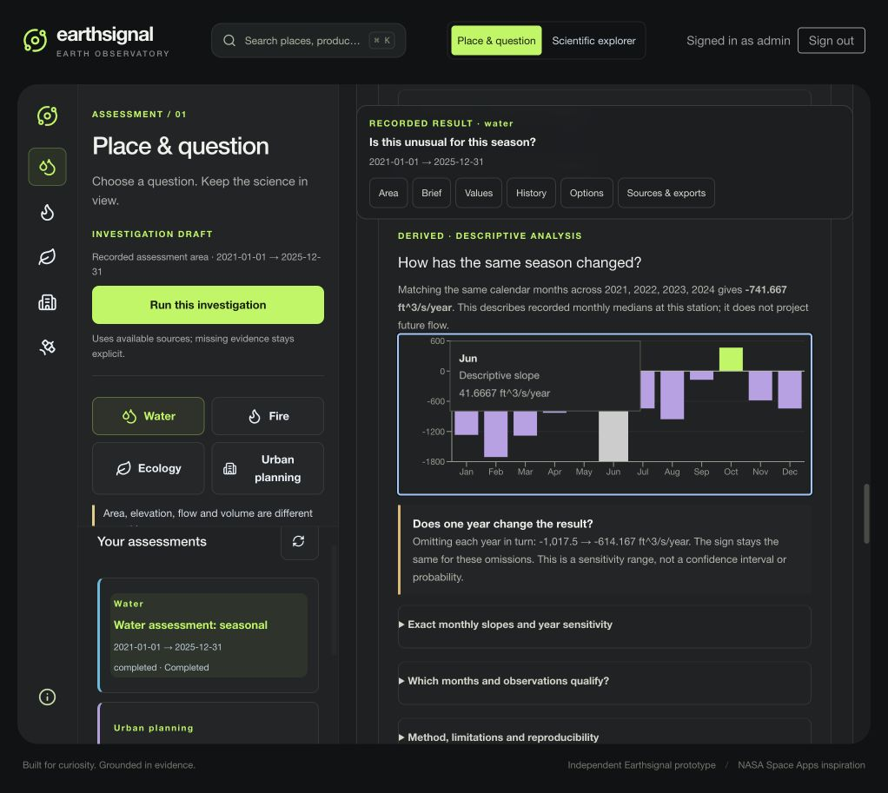
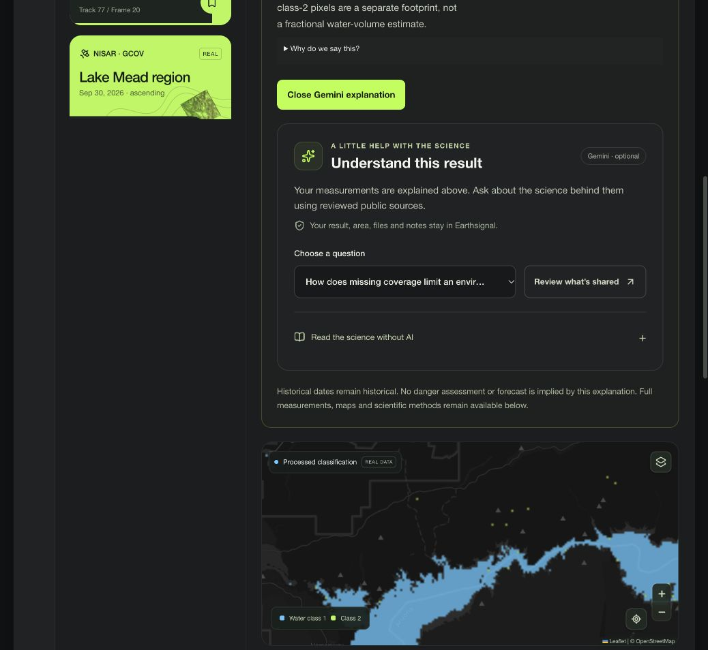

<div align="center">


# 🛰️ Earthsignal

The interactive public story opens at `/`, with Tehran/Tokyo exploration at `/explore`, comparisons at `/compare`, and the scientific investigation tools at `/workspace`. All ship through the root Vinext build. See [public integration and feature parity](docs/public-story.md) and the [public design system](DESIGN.md).

### 📷 Start with a photo



Choose a photo or take one on your phone, confirm its location, and find dated
NISAR radar observations there. Photos stay on your device. No saved GPS? Pick a
place on the map instead. [How it works and what the results mean](docs/photo-location.md).

## Earth is changing. Make sense of it.

Explore a place, see what changed, and understand what the evidence can tell you. Earthsignal brings satellite maps, plain-language explanations and the full scientific tools into one workspace.

For scientists exploring a question, planners comparing places, and decision-makers deciding what to check next. 🌱

**[🌍 Open the observatory](https://nasa.r8volt.com)** · **[📖 Explore the docs](docs/index.md)** · **[🔬 Inspect the evidence](docs/reproducibility.md)**

[⚙️ CI: web & gateway · Python · native GDAL](https://github.com/meowtappeparlechat/earthsignal/actions/workflows/ci.yml)

**Research prototype** · Real measurements · Field and decision validation in progress

</div>

## 🔎 A real scientific puzzle

**Does a weaker radar signal mean less water?** Our original study covers a
small island-and-water patch. New optical images show water classifications
changing in both directions, with some shoreline pixels uncertain. That is a
reason to investigate—not a whole-lake diagnosis.

[Explore the real images, recorded inputs and reproducible checks →](examples/optical-reference-development/README.md)

## 🤝 Help check the maps

You do not need to be a satellite specialist to help. Our guided collaborator
exercise shows the same small square on two dates and walks you through what
is visible, what is unclear and why. Export your draft to keep your work.

After separate first-pass reviews, compare two saved drafts to find disagreements
and missing answers. Both originals stay intact. Matching answers are a useful
clue—not proof that a map is correct.

[How the guided review works →](docs/optical-reference-review.md)

🧮 Scientists can also explore [a reproducible sampling experiment](examples/stratified-area-demo/README.md): why counting deliberately oversampled changes can give the wrong impression of a whole place. The example is synthetic, with assumptions and uncertainty kept visible.

The [guided Sampling & uncertainty workspace](docs/sampling-workspace.md) brings that experiment into private job history: inspect your input, run it, read the result in simple terms and keep full scientific exports. Unfinished answers visibly withhold estimates.

💧 **Images are visits, not continuous watching.** The water-history walkthrough lets you inspect dated fictional records, unclear views and gaps, then compare how different weighting and date exclusions change a summary. [Native method & reproducible examples →](docs/water-sampling-sensitivity.md) Neither percentage means percent of days wet.

🧪 **A useful result can be “we need more evidence.”** Our first fixed real flood-data check found usable coverage over only 12% of its small patch, with no mapped flood examples. The case, original cropped values and repeatable checks are included in this repository. [See what the evidence supports →](docs/geoid-development.md)

## 🧭 Start with a place and a question

1. **Place** — find a city, choose an example, or draw your own area.
2. **Question** — choose water, fire, plants & forests, or cities & heat. Pick what you want to understand.
3. **Dates** — choose the period, check available sources, then **Explore changes** with your collaborator account.

Already have a radar comparison? You can choose it in the dates step and explicitly reuse its area and dates.



*Question menu, captured from production on 10 October 2026. Cropped to this public control; account information and saved results are omitted.*

## 💡 A result you can actually understand

Completed investigations begin with **In simple terms**:

- **What changed** — the measured quantity, place, dates and usable coverage.
- **What this means** — supported interpretations in everyday language.
- **What we cannot tell** — gaps, competing explanations and limits.
- **What to check next** — the next useful observation or field check.

Open **Why do we say this?** to inspect the underlying measurements and sources. Optional Gemini help explains the public science after you review what will be shared; private results, areas and notes stay in Earthsignal.

Satellite signals are clues. Confirming deforestation, damage or danger requires suitable additional evidence. Forecasts are experimental; planning scenarios show assumptions, not guaranteed outcomes.

## 🌍 Pick the question that matters to your place

- 💧 **Water:** investigate water coverage and flow at measuring stations. Area, water level, flow and volume remain distinct.
- 🔥 **Fire:** inspect recorded heat detections and environmental context. Detections alone do not establish a burning footprint or damage.
- 🌿 **Plants & forests:** explore vegetation, moisture and recovery. Greenness alone does not establish biodiversity or deforestation.
- 🏙️ **Cities & heat:** compare ground-surface temperature and candidate places. Ground temperature differs from air temperature and human exposure.

Availability depends on the source, place and date. Missing evidence stays visible. [See supported sources →](docs/source-registry.md)

## 🔬 Simple entry. Room to go deeper.

Keep the map, explanation and evidence together—or open **Scientific explorer** for radar acquisitions, compatibility checks and detailed analysis.

- Compare before/after layers, masks, histograms and histories.
- Inspect pixels, polygons, transects and annotations.
- Compare planning options with their assumptions and tradeoffs.
- Save snapshots and export a brief, investigation or protected scientific download.
- Find places, observations and workspace actions with **⌘K / Ctrl+K**.

The result's navigation is **In simple terms → Area → Measurements & history → Compare options → Sources & exports**. [Environmental workflow →](docs/environmental-change.md) · [Scientific analytics →](docs/analytics.md)

Press **⌘K / Ctrl+K** to search loaded observations, saved findings, measurements, history charts, source evidence and snapshots. Exact queries such as `track:85 product:GCOV` retain scientific metadata; opening evidence preserves your investigation draft. [Search syntax and scope →](docs/universal-search.md)

Public discovery is available without sign-in. Processing, protected studies and downloads require an operator-provided collaborator account.

<details>
<summary><strong>🛰️ Inspect the reproducible NISAR study</strong></summary>

### One real radar comparison

**Lake Mead-region patch · 26 June → 30 September 2026 · NISAR L2 GCOV**

| Recorded quantity | Result |
|---|---:|
| Median matched-pixel backscatter difference | **−1.46 dB** |
| Common valid area | **1.0002 km²** |
| Common valid coverage | **93.3%** |

**What this supports:** a difference in returned radar signal over the common valid pixels of this small patch. Moisture, vegetation, roughness, speckle and acquisition conditions can influence that signal. A named environmental cause, whole-lake change, hazard or intervention benefit requires additional evidence.

[Original manifest](examples/prepared-study/manifest.json) · [Reproduction receipt](examples/prepared-study/verification.json) · [Masks and scientific definitions](docs/science.md) · [Reproduce the study](docs/reproducibility.md)

</details>

<details>
<summary><strong>🧪 What's implemented, experimental or still research?</strong></summary>

### Capability and validation status

| Capability | Status | Evidence and boundaries |
|---|---|---|
| Native radar comparisons, maps and analytics | **Implemented** | Before/after layers, histograms, pixel probes, polygon statistics, transects and annotations. [Analytics](docs/analytics.md). |
| Bounded environmental assessments and explanations | **Implemented** | Source-backed indicators, historical/seasonal summaries, compatible-context checks and practical next questions. [Methods](docs/observatory-methods.md). |
| Evidence exports and saved assessment snapshots | **Implemented** | Protected rasters, JSON/CSV, locally exported investigations and print/save-PDF briefs. [Reproducibility](docs/reproducibility.md). |
| Station-discharge models | **Experimental** | Workspace reports retain chronological selection, calibration and retrospective holdout comparisons. A separate [offline frozen-policy experiment](docs/forecast-policy.md) records issue-time baselines, abstentions and later outcome scores; it has no validated prospective skill or live activation. [Forecast boundaries](docs/environmental-change.md#complementary-predictions). |
| Thresholds and planning alternatives | **Assumption-based scenarios** | Recorded inputs and tradeoffs; these comparisons do not establish causal intervention effects. [Methods](docs/observatory-methods.md). |
| Additional disturbance products and advanced model experiments | **Proposed research** | Cropped products, independent reference sampling and richer model experiments need separate acceptance. [Research package](docs/research/academic-data-2026-10-10/README.md). |

Operational hazard performance, a matched environmental case and improved real decision outcomes remain to be established. See the [source capability registry](docs/source-registry.md) for source-by-source availability.

</details>

<details>
<summary><strong>📸 More of the real workspace</strong></summary>



*Earlier live capture, 10 October 2026: recorded urban assessment. The requested window is June 2025; actual paired observations are 9 and 25 June. This preserves the recorded result, not a matched NISAR environmental event.*



*Live capture, 10 October 2026: historical station analysis with same-season comparisons and year sensitivity. Its descriptive slopes are distinct from future forecasts.*



*Live capture, 10 October 2026: the scientific explorer. Optional Gemini questions require review and approval of public information. Private measurements and notes are explained locally. Recorded Gemini inference returned HTTP 503 on this date; local explanations and the non-AI science library remain usable.*

</details>

<details>
<summary><strong>🛠️ Run locally</strong></summary>

Use Node **22.13+**. The web workspace runs independently; processing uses a separate Python/FastAPI service.

```sh
npm ci
npm run dev
# Open http://127.0.0.1:5173
```

For local collaborator sign-in, configure the shell that launches the app:

```sh
umask 077
mkdir -p .earthsignal
export EARTHSIGNAL_AUTH_DB="$PWD/.earthsignal/auth.sqlite3"
export EARTHSIGNAL_PUBLIC_ORIGIN=http://127.0.0.1:5173
npm run collaborator -- provision yourname
npm run dev
```

Follow [Contributing](CONTRIBUTING.md) for verification, the [service guide](service/README.md) for processing and [Deployment](docs/deployment.md) for hosting. Local setup does not supply Earthdata credentials or production results.

</details>

## 🤝 Help make the science and the product better

[Report a bug](https://github.com/meowtappeparlechat/earthsignal/issues/new?template=01-bug-report.yml) · [Question a scientific result](https://github.com/meowtappeparlechat/earthsignal/issues/new?template=02-scientific-discrepancy.yml) · [Propose an improvement](https://github.com/meowtappeparlechat/earthsignal/issues/new?template=03-feature-request.yml)

For collaborators: [Contribution guide](CONTRIBUTING.md) · [Security reporting](SECURITY.md) · [How to cite the work](CITATION.md) · [Documentation hub](docs/index.md)

Detailed [implementation checkpoints](docs/decision-observatory.md), [design QA](design-qa.md) and [archived project history](docs/project-history.md) retain the methods, decisions, verification and open gaps behind this overview.

---

**Built for curiosity. Grounded in evidence.** 🌍

Inspired by NASA Space Apps **Dancing with the SARs**. Independently built; NASA affiliation or competition selection is not implied.

🔒 **Private collaborator repository.** Source, methods and reproduction recipes stay together so collaborators can understand, challenge and improve the work. Ownership and permissions are described in [Contributing](CONTRIBUTING.md).
