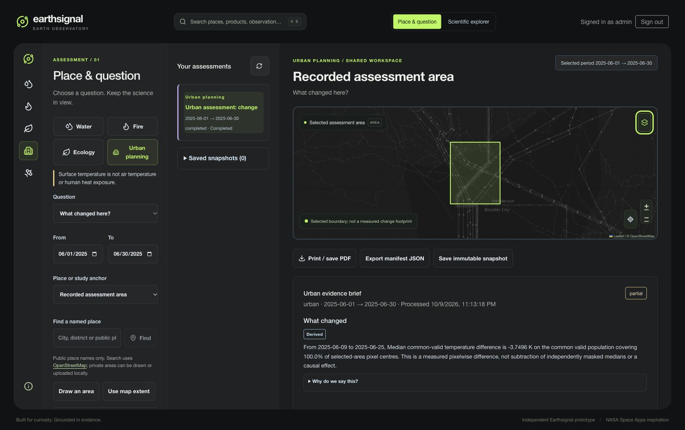
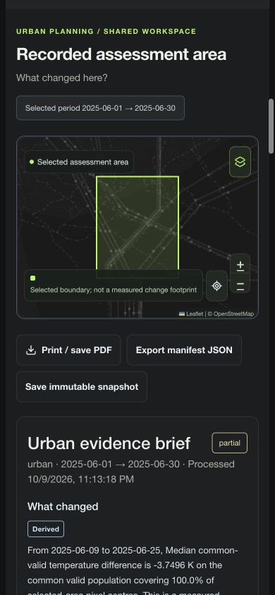
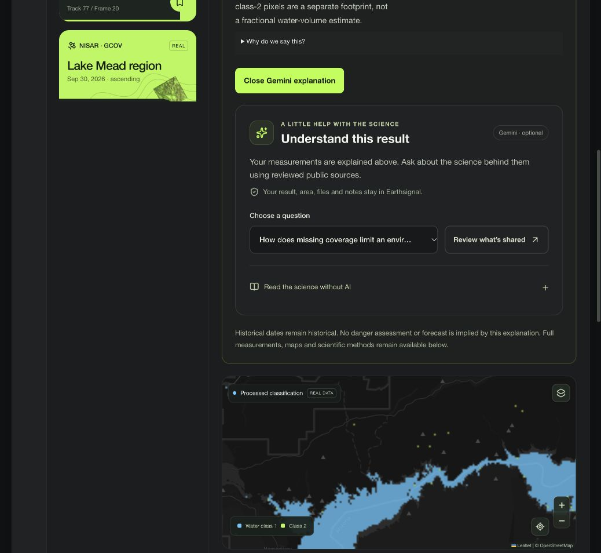
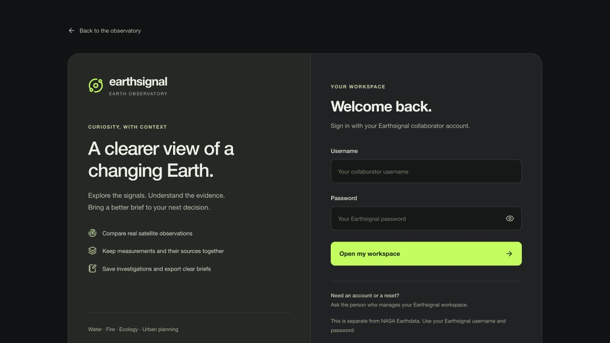

# Place & question design QA — 2026-10-09

Target: preserve the scientific workspace and give Place & question the same charcoal/lime visual system. The supplied car dashboard is layout/style inspiration, not application content.

## Reference and captures

- User reference: `/Users/amireza/Downloads/original-02b517707505d173de4d7b7617ae3b8f.webp` (1600×1200).
- Existing scientific workspace: `.sites-runtime/design/scientific-reference.png`, full-page capture with 1600×1000 viewport.
- Implementation: `.sites-runtime/design/decision-desktop.png` (same desktop viewport), `decision-mobile.png` and `decision-mobile-map.png` (390×844).
- Joint comparison: `.sites-runtime/design/design-comparison.png`. All three panels inspected in one image. Normalization preserves aspect ratio, fits each to 520×400 and pads the remainder; the scientific page's full detail stack is taller than the initial decision view.

## Findings and repairs

Initial delegated CSS was rejected: escaped root selector and broad flex-to-grid replacements hid content and corrupted controls. Coordinator restored actual scoped selectors, flex controls and a four-column desktop grid, then recaptured.

1. Layout: rounded shared frame; slim workflow rail, filters, real assessment collection and right map/details. No fabricated collection cards. Desktop controls/details scroll independently; mobile content remains fully reachable with a direct map anchor.
2. Typography: shared Inter hierarchy, light foreground and restrained uppercase lime section labels. Inline scientific units and distinct claim labels remain legible.
3. Spacing: corrected date-input minimum widths and refresh-button sizing; 44px primary/rail controls. Optional limits/settings use disclosures. At 390px, document scrollWidth equals viewport width: 390px.
4. Colors/surfaces: charcoal panels and lime selection/primary actions match the scientific explorer. Semantic claim colors are retained with text labels and borders; they are not used alone to convey certainty.
5. Imagery/data: actual georeferenced maps and recorded AOI boundary. No car imagery, invented data or synthetic environmental measurements. Boundary explicitly says it is not a measured footprint.

## Interaction checks

- Switching to Scientific explorer reveals the existing 25-record water/radar collection, filters, historical gauge chart and forecast experiment.
- Switching domain/question preserves place and dates.
- Mobile map shortcut moves the measured/map workspace to the viewport (top approximately 12px), without overflow.
- Full scientific search remains mounted; search actions switch to the scientific view.
- Account-change epoch guards clear private areas/history and suppress late responses; uploads guard account transitions. Scenario panel resets on selected assessment ID.
- Numerical display conversion distinguishes absolute kelvin from temperature differences; source values remain unchanged.
- Local preview has no collaborator server configuration; successful signed-in jobs, protected images and public Gemini response are production checks recorded separately. Human comprehension/WCAG certification is not inferred from this visual QA.

Visual QA result: **passed** for the requested style/layout correction. Production workflow acceptance and human comprehension remain separate gates.

## Production verification

The deployed desktop view has one raster section and one scenario panel after selection and history refresh; all six swipe/small-multiple images decode at 420px. The mobile view has document width 390px, no page overflow and map shortcut top 12px. The original scientific explorer still exposes historical water/gauge/forecast tools and protected radar comparisons. Native date editing works; browser-automation fill alone does not commit Chromium date fields, so verification used native arrow-key editing.

## Science guide and collaborator sign-in — 2026-10-10

Before: the supplied screenshot showed an oversized, unstructured assistant with the same question in a select and read-only textarea. Form styles depended on the decision-workspace ancestor, so the scientific-detail instance lost its layout. The old sign-in was a bare single-column form (`outputs/plain-language/05-sign-in-before.png`).

Repairs: independently styled charcoal/lime guide, one question picker, expandable public-information review, visible per-call approval and one primary action. The reviewed science library works without AI or sign-in. Sign-in has a branded desktop split layout, single mobile column, labelled fields, password visibility and a clear primary action. Scientific detail and authorization remain intact; no conclusions are simplified into unsupported hazard labels.

Verified on actual production: successful sign-in returns to the authenticated workspace; changing the question clears review/approval; guide and sign-in reflow at390×844 with390px document width. Pointer/Space password toggle checked locally. Independent Sol review found a hashing/consent invalidation race, now closed by a deferred-hash zero-transmission regression.94 web tests, TypeScript, scoped lint/build and Python/native-GDAL CI pass. Visual QA passes this scoped correction; user comprehension and WCAG certification remain unverified.

Mobile receipts: [science guide](docs/images/science-guide-live-mobile.png), [sign-in](docs/images/sign-in-live-mobile.png).
