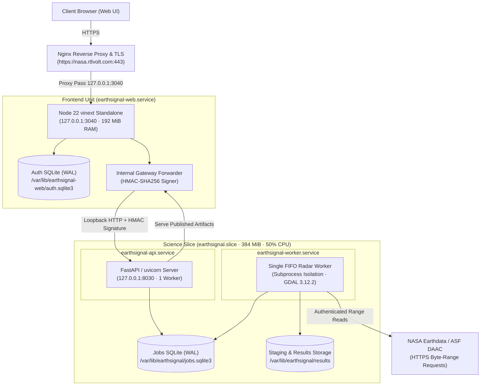

# System Architecture

Earthsignal Observatory is structured around a decoupled, security-hardened architecture that separates user-facing web services from scientific computing pipelines. It is deployed as a standalone Node.js and Python stack without external platform runtime dependencies (e.g., no Cloudflare Sites runtime).

---

## Architecture Topology



---

## Component Breakdown

### 1. Reverse Proxy & TLS (`nginx`)
- **Public Domain**: `https://nasa.r8volt.com`
- **TLS Termination**: Let's Encrypt automated TLS certificate (with automated Certbot renewal timer and nginx hook).
- **Security Headers**: TLS1.2/1.3, nosniff, `Cache-Control: private, no-store` on sensitive application routes, and strict request size limits (16 KB max for API mutations).

### 2. Frontend Web Application (`earthsignal-web`)
- **Runtime**: Native Node.js `>=22.13.0` running the standalone `vinext` production server (`dist/standalone/server.js`).
- **Resource Boundary**: Dedicated system user `earthsignal-web`, memory capped at 192 MiB in its systemd unit.
- **Port**: Listens on internal loopback `127.0.0.1:3040`.
- **Collaborator Authentication (`lib/local-auth.ts`)**:
  - Implements local collaborator management using Node's built-in `node:sqlite` (`DatabaseSync`).
  - Database stored at `/var/lib/earthsignal-web/auth.sqlite3` with strict mode `0600` permissions.
  - Password hashing: scrypt with OWASP parameters:
    - $N = 16384$ ($2^{14}$), $r = 8$, $p = 5$ (16 MiB memory footprint), 64-byte key length.
    - Constant-time verification against timing attacks.
    - Passwords must be at least 15 characters; public registration is disabled; use separate application passwords; password reuse is not mechanically detected.
  - Session management:
    - High-entropy 32-byte cryptographically secure random token (43 base64url characters).
    - Database stores only the SHA-256 hash of the session token.
    - Cookie: `__Host-earthsignal-session` (in production) or `earthsignal-session` (in development), with flags `Path=/`, `HttpOnly`, `SameSite=Lax`, `Secure`.
    - Session limits: 7-day absolute lifetime, 24-hour idle timeout, max 8 concurrent sessions per user.
  - CSRF Defense:
    - Strict Origin header verification: must match `EARTHSIGNAL_PUBLIC_ORIGIN` (`https://nasa.r8volt.com`).
  - Rate Limiting:
    - Global limit: 30 login attempts / 60 seconds.
    - Per-username limit: 5 attempts / 15 minutes across 256 hashed buckets.
    - Hash queue: one active derivation and at most4 waiting to protect system resources.

### 3. Gateway HMAC Protocol (`lib/radar-gateway.ts`)
- Serves as the trusted intermediary between authenticated frontend sessions and the backend science service.
- Disallows direct browser access to the science backend.
- Signs every forwarded request using HMAC-SHA256 with the shared `EARTHSIGNAL_GATEWAY_SECRET` (minimum 32 bytes).
- Canonical signature format:
  ```
  METHOD\nPATH_AND_QUERY\nUSER\nTIMESTAMP\nNONCE\nSHA256(raw_body)
  ```
- Replay protection:
  - Timestamp must be within $\pm 60$ seconds of the server clock.
  - Unique nonce (16 to 128 characters) recorded in the backend SQLite `nonces` table, persisting across restarts.

### 4. Science Processing Backend (`earthsignal-api` & `earthsignal-worker`)
- **Slice Allocation**: Managed under `earthsignal.slice`:
  - `MemoryMax=384M` (no swap: `MemorySwapMax=0`)
  - `CPUQuota=50%`
  - `TasksMax=32`
- **User Account**: Dedicated system user `earthsignal`.
- **API Server (`service.api`)**:
  - FastAPI / uvicorn listening on `127.0.0.1:8030`.
  - Runs a single worker process with strict concurrency (`limit_concurrency=16`, `backlog=16`).
  - Validates HMAC signatures, checks replay nonces, enforces owner quotas, and enqueues jobs into SQLite.
- **Worker Daemon (`service.worker`)**:
  - Single FIFO worker pulling jobs from `/var/lib/earthsignal/jobs.sqlite3`.
  - Enforces exclusivity using an OS advisory file lock (`worker.lock`).
  - Executes each job in an isolated subprocess (`service.run_job`), stripping gateway secrets from child environment.
  - Monitors subprocess heartbeats, monotonic wall-clock limits (max 1200s), and storage limits (1 GiB ceiling, 3 GiB reserve).
  - Performs atomic publishing: generates all 9 required artifacts in staging, fsyncs files and directory, renames onto `/var/lib/earthsignal/results/<id>`, and commits completed status to SQLite.
