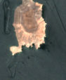
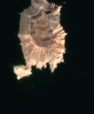

# 🛰️ Is a quieter radar signal a smaller lake?

This real, frozen **development case** checks optical context for Earthsignal's
original radar patch. It is an island-and-water patch at
`[-114.75, 36.05, -114.74, 36.06]`, not the whole of Lake Mead.
The original radar acquisitions, median −1.461262 dB and common valid area
1.0002 km² remain unchanged.

| 28 June 2026 | 1 October 2026 |
|---|---|
|  |  |

Both RGB previews use the same reflectance scale (0–0.3, clipped for display).
These previews establish neither water depth nor the cause of darker radar
backscatter. Wind, surface roughness and other conditions remain competing
explanations requiring additional evidence.

## What the independent sensor actually provides

Earth Search returned Sentinel-2 L2A items
`S2B_T11SPV_20260628T182412_L2A` and
`S2C_T11SPV_20261001T182825_L2A`. Their observations are approximately two days
after the 26 June radar acquisition and one day after the 30 September radar
acquisition. That temporal mismatch remains part of the interpretation.

On the native **20 m optical classification grid**, the polygon contains
2,499 pixel centres. SCL class6 marks2,201 pixels as water before and2,180 after.
**46 pixels are uncertain at an endpoint**:42 class2 and four cloud-class pixels
in the later image. Tile-level cloud percentages therefore cannot establish
cloud-free coverage of this patch.

Among2,453 pixels assigned SCL classes4/5/6 at both dates:

| Optical classifier transition | Pixels |
|---|---:|
| Nonvegetated → nonvegetated | 234 |
| Water → water | 2,153 |
| Nonvegetated → water | 27 |
| Water → nonvegetated | 39 |

These are **unreviewed classifier transitions**, not verified shoreline changes.
Mixed pixels, shadow, classification error and the date mismatch can matter.
Unknown pixels stay unknown. Nominal projected optical cell area is400 m²;
this is neither geodesic area nor a sampling-adjusted area estimate. Optical
and radar populations have different grids and masks and must not be equated.
No radar input was resampled, and no optical label was assigned to a radar cell.

## Reproduce the checks offline

### Help review the images

Earthsignal now includes a [guided interpretation exercise](../../docs/optical-reference-review.md)
for first-time collaborators. It selects 40 native optical cells, hides the
classifier's proposed labels and keeps missing visibility and uncertainty useful.
Private draft exports can be resumed and independently inspected. The exercise
collects human interpretations; it supplies no validated accuracy or radar labels.

### Verify the frozen measurements

From the repository root:

```sh
service/.venv/bin/python -m service.verify_optical_reference
service/.venv/bin/python -m unittest service.tests.test_optical_reference -v
```

The verifier pins the original receipt and STAC metadata hashes, checks each
compressed archive and extracted array/mask hash, and reconciles the complete
population and uncertain pixels. `receipt.json` contains source asset metadata,
ETags, native transforms, masks, counts and input hashes. `source-items.json`
contains the exact selected public STAC items. Acquisition times are source
timestamps; the first operator receipt did not record per-request retrieval
timestamps, so none have been invented.

## Repeat the bounded acquisition

On a verified native-GDAL runtime, from the repository root:

```sh
PYTHONPATH=. service/.venv/bin/python examples/optical-reference-development/acquire.py --output /tmp/earthsignal-new-optical-windows
```

Use a new output directory. The recipe accepts only the pinned source items,
reads COG byte ranges through the existing allowlisted transport, shares a
32 MiB transfer budget and checks the one-million-pixel bound. It supplies no
Earthdata credentials. The actual server experiment fetched **6,307,848 bytes**,
took23.64 s and recorded127,180 KiB process maximum RSS. It ran in a transient
systemd unit capped at160 MiB, quarter CPU and200 s, inside the existing capped
science slice. The observed cgroup peak reached160 MiB; RSS alone understates
total charged memory. This small crop is not a general throughput benchmark.

## Rights and scientific status

**Contains modified Copernicus Sentinel data2026.** ESA is the producer;
Element84/Sinergise supply processing and AWS hosts these COGs.
The STAC collection's licence string is `proprietary`, linked to the
[Copernicus Sentinel legal notice](https://sentinels.copernicus.eu/documents/247904/690755/Sentinel_Data_Legal_Notice).
The notice permits lawful reproduction/adaptation/distribution with attribution;
this is **not a claim of CC BY equivalence** or permission over unrelated code.
See the [official processing description](https://sentiwiki.copernicus.eu/web/s2-processing)
for SCL classes and limitations.

This case has already been inspected. It is **development/visibility evidence**,
excluded from untouched final evaluation. It supplies no independently reviewed
quiet/change labels, measured detector error, operational forecast skill or human
usefulness evidence. Those remain required before scientific promotion.
